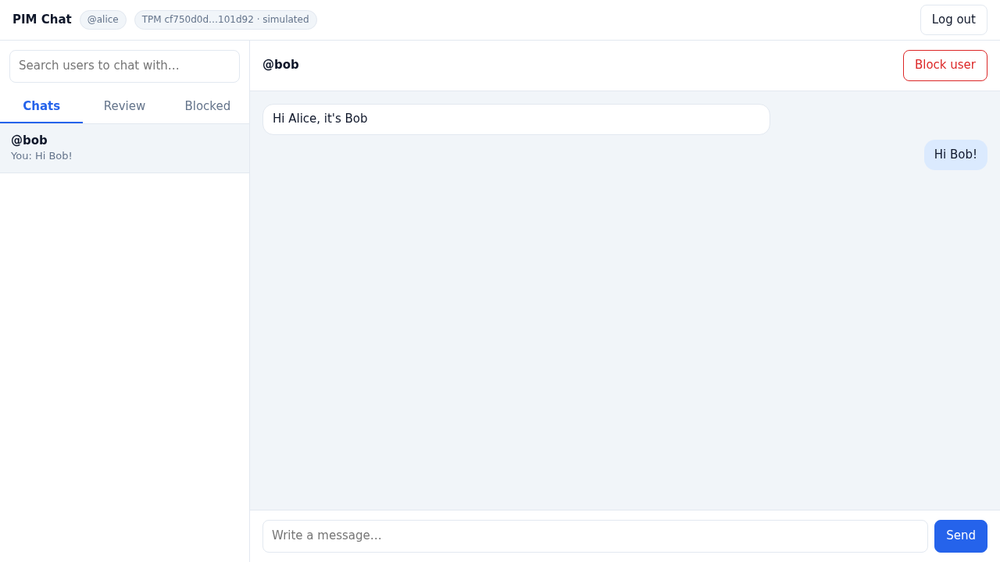
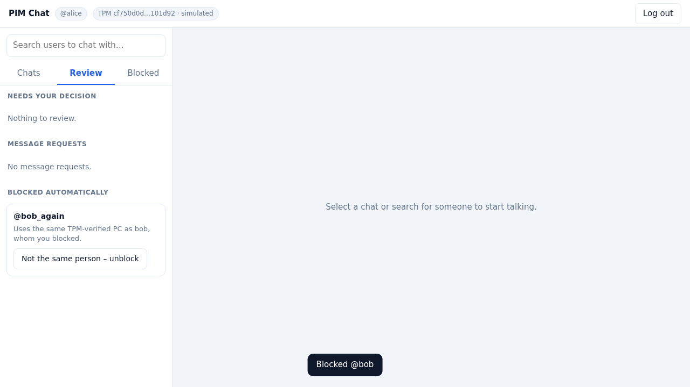
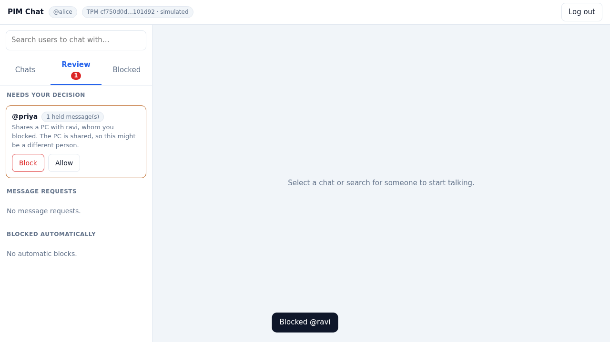

# FIDO2 PIM Chat — *the block follows the person, not the account*

A secure chat system built on **FIDO2 / WebAuthn (Windows Hello)** and **TPM 2.0 hardware identity**, with a
**Policy Engine** that stops blocked users from returning with a fresh account.

> Course project · **20CYS401 Secure Software Engineering** · Amrita School of Computing
> Team: **P. Abhinav** (Project Lead & Backend) · **B. Hemanth Kumar** (Security Engineer) · **P. Jashwanth** (Frontend)



---

## The problem

On almost every platform, blocking someone only blocks **one account**. The blocked person creates a new e-mail,
signs up again, and is back in your inbox within a minute. The block is attached to something that costs nothing to replace.

## The idea

FIDO2 PIM (**P**ersistent **I**dentity **M**anagement) attaches the block to signals that are **expensive to replace**,
and checks them in priority order:

| Priority | Signal | Cost to evade | How it is proven |
|:-:|---|---|---|
| 1 | **PC hardware** (TPM 2.0 Endorsement Key) | buy a new PC | read from the TPM chip by the client agent, hashed **by the server** |
| 2 | **Phone number** | buy a new SIM | OTP code |
| 3 | **Gmail address** | free, so alias tricks are caught | OTP code + normalisation (`ra.vi+x@gmail.com` → `ravi@gmail.com`) |

Login itself is **password + Windows Hello** (FIDO2), so a stolen password alone is useless.

## What makes it special

* **Hardware-anchored blocks.** When *alice* blocks *bob* and bob registers `bob_again` with a brand-new Gmail and phone
  on the same PC, the TPM gives him away and the new account is **blocked automatically**. bob never finds out:
  alice simply shows up as *"User not found"*.
* **Families aren't punished.** If the PC was **already shared** by several people *before* the block, a match only creates a
  **soft block**. The new account's messages are held, and alice decides with **Allow** or **Block**. The system tells
  "same person, new account" apart from "sister on the family PC".
* **Two hardware channels, on purpose.** WebAuthn is designed to be *unlinkable* (each registration gets a fresh key pair),
  so it can never say "this is the same PC". The TPM provides that stable identity separately. Each one does the job it is built for.
* **No TLS certificates needed for Windows Hello.** A small local agent serves the GUI on `http://localhost`, which browsers
  treat as a secure origin. WebAuthn works out of the box, and the agent attaches the TPM identity to every request.
* **Secure by design:** fail-closed Policy Engine, block rows written in the *same DB transaction* that creates the account
  (no race window), login lockout, OTP-gated new-PC enrolment (UC-06), a full audit log with a live admin page, and a STRIDE threat model.
* **Fully tested without hardware:** 42 automated tests run the server's *real* WebAuthn verification against a software
  FIDO2 authenticator and simulated TPMs, plus a Playwright end-to-end browser check.

### Policy Engine decisions

| Situation when a new account appears | Result | What the blocker sees |
|---|---|---|
| Same **TPM** as a blocked account, PC **not shared** before the block | `BLOCK` (automatic) | *Blocked automatically* (can undo) |
| Same **TPM**, PC **already shared** before the block | `SOFT`: messages held | *Needs your decision* → Allow / Block |
| Same **phone number**, no TPM match | `REQUEST` | *Message requests* |
| Gmail alias of an existing address | registration refused, logged as evasion attempt | admin audit log |
| No match | normal chat | – |

Every search, profile view and message passes through `PolicyEngine.evaluate_interaction`. Any internal error → **deny** (fail closed).

---

## Architecture

```
 USER PC (PC-1, PC-2)                                                 SERVER PC (PC-3)
┌────────────────────────────────────────────┐                  ┌────────────────────────────────┐
│ Browser  http://localhost:8765             │                  │  FastAPI  (SERVER/)            │
│   chat GUI + Windows Hello (WebAuthn)      │                  │   account_service  UC-01/02/06 │
│        │                                   │   HTTP + header  │   webauthn_service (FIDO2)     │
│        ▼                                   │   X-Device-Info  │   device_service   TPM devices │
│ Client agent (CLIENT/client_agent.py)  ────┼─────────────────►│   policy_engine    UC-03..05   │
│   · serves the GUI                         │                  │   block_service    UC-07/08    │
│   · reads the TPM Endorsement Key          │                  │   chat_service     messaging   │
│     (CLIENT/tpm_reader.py → PowerShell)    │                  │   SQLite (SERVER/DATA/)        │
└────────────────────────────────────────────┘                  └────────────────────────────────┘
```

The **server** is the Identity Provider (IdP) + Policy Engine + chat API. The **client** is a per-PC agent; the browser
only ever talks to `localhost`, and the agent forwards requests to the server. More detail: [DOCS/ARCHITECTURE.md](DOCS/ARCHITECTURE.md).

**Tech stack:** Python 3.10+, FastAPI, Uvicorn, SQLite, [`webauthn`](https://pypi.org/project/webauthn/), `cryptography`,
vanilla HTML/CSS/JS, PowerShell (`Get-TpmEndorsementKeyInfo`), pytest, Playwright.

## Repository layout

```
FIDO2-PIM-CHAT/
├── SERVER/                 IdP + Policy Engine + chat API (self-contained → copy to PC-3)
│   ├── start_policy_engine_from_scratch.ps1   one-click: venv + packages + firewall + start
│   ├── run_server.py       entry point
│   ├── policy_engine.py    TPM > phone > Gmail decisions, interaction enforcement
│   ├── webauthn_service.py FIDO2 registration / assertion verification
│   ├── device_service.py   TPM EK → device identity, shared-PC detection
│   ├── database_schema.sql
│   └── DATA/               SQLite database is created here at runtime (git-ignored)
├── CLIENT/                 per-PC agent + chat GUI (self-contained → copy to PC-1 and PC-2)
│   ├── start_client_from_scratch.ps1          one-click: venv + packages + admin + TPM + start
│   ├── check_tpm.ps1       pre-flight check: can this PC's TPM be read?
│   ├── run_client.py       entry point
│   ├── tpm_reader.py       reads the TPM EK (real or simulated)
│   ├── WEB/                chat GUI (HTML / CSS / JS, Windows Hello via WebAuthn)
│   └── SIMULATED_TPM/      fake TPMs for PCs without one (git-ignored contents)
├── TESTS/                  42 pytest tests + Playwright end-to-end check
├── SCRIPTS/                one-PC demo launcher, database reset
├── DOCS/                   architecture + STRIDE, use cases, 3-PC guide, team contribution, screenshots
└── REQUIREMENTS.txt        everything (server + client + tests) for single-PC development
```

---

## Running across three PCs (IdP + 2 clients)

| | **PC-3: Server (IdP)** | **PC-1: USER1** | **PC-2: USER2** |
|---|---|---|---|
| Copy this folder | `SERVER\` | `CLIENT\` | `CLIENT\` |
| Needs | Python 3.10+ | Python 3.10+, TPM 2.0, Windows Hello PIN | Python 3.10+, TPM 2.0, Windows Hello PIN |
| Runs | `start_policy_engine_from_scratch.ps1` | `start_client_from_scratch.ps1` | `start_client_from_scratch.ps1` |

### Step 0: Prepare all three PCs

1. **Install Python 3.10+** from [python.org](https://www.python.org/downloads/) and tick **"Add python.exe to PATH"**.
2. **Put all three PCs on the same network.** A **mobile hotspot** works best; campus/office Wi-Fi often blocks PC-to-PC traffic (client isolation).
3. **On PC-1 and PC-2 only:**
   * Set up a Windows Hello PIN: *Settings → Accounts → Sign-in options → PIN (Windows Hello)*.
   * Check that the TPM is enabled: in an **Administrator** PowerShell, `Get-Tpm` must show `TpmPresent : True` and `TpmReady : True`.
     If not, enable **fTPM** (AMD) or **PTT** (Intel) in the BIOS.
4. If PowerShell refuses to run scripts, run this once in that window:
   ```powershell
   Set-ExecutionPolicy -Scope Process Bypass
   ```

### Step 1: Start the server on PC-3 (always first)

Open **PowerShell as Administrator** (so the script can open the firewall port) inside the copied `SERVER` folder:

```powershell
cd SERVER
.\start_policy_engine_from_scratch.ps1 -RealTpmOnly
```

The script will:
* create `SERVER\.venv` and install `server_requirements.txt`,
* add an inbound firewall rule for **TCP 8000**,
* **print the exact command the clients must run**, including PC-3's IP, for example
  `.\start_client_from_scratch.ps1 -Server http://192.168.43.10:8000`,
* print an **admin link** `http://localhost:8000/admin?token=...` that shows devices, blocks and every Policy Engine decision live.

> ⚠️ **Keep this window visible.** The mock **SMS and Gmail OTP codes are printed here** during registration.

| Server option | Effect |
|---|---|
| `-RealTpmOnly` | refuse simulated TPMs (use this for the real 3-PC demo) |
| `-Reset` | delete the database first (start with zero accounts) |
| `-ShowOtpInPages` | also show OTP codes inside the web page (handy for solo testing) |
| `-Port 9000` | listen on a different port |

To find PC-3's IP manually: `ipconfig`, then use the *IPv4 Address* of the Wi-Fi/hotspot adapter.
From PC-1 you can test connectivity with `Test-NetConnection <PC-3 IP> -Port 8000` (look for `TcpTestSucceeded : True`).

### Step 2: Start the client on PC-1 and on PC-2

Inside the copied `CLIENT` folder on **each** user PC:

```powershell
cd CLIENT
.\check_tpm.ps1                                             # once, as Administrator: must end with "OK"
.\start_client_from_scratch.ps1 -Server http://<PC-3 IP>:8000
```

The script will:
* **re-open itself as Administrator** (Windows only lets administrators read the TPM Endorsement Key),
* create `CLIENT\.venv` and install `client_requirements.txt`,
* check that the server answers on `/health`,
* read the TPM and open the chat page at **`http://localhost:8765`**.

> **Always use exactly `http://localhost:8765`**, not `127.0.0.1` and not the PC's IP. Windows Hello (WebAuthn) is bound to the
> relying-party ID `localhost` and will refuse any other origin.

**No TPM on a client PC?** Start the server *without* `-RealTpmOnly`, then on the client:

```powershell
.\start_client_from_scratch.ps1 -Server http://<PC-3 IP>:8000 -Simulated -TpmName PC-2
```

### Step 3: Demo walkthrough

| # | Where | Action | What it proves |
|:-:|---|---|---|
| 1 | PC-1 | Register **alice**. Enter the OTP codes shown in the **PC-3 window**. Confirm with Windows Hello. | UC-01: password + OTP + FIDO2 + TPM registration |
| 2 | PC-2 | Register **bob**, search for alice and send a message; alice replies. | Normal chat |
| 3 | PC-1 | alice opens the chat and presses **Block user**. | UC-03 |
| 4 | PC-2 | bob searches for alice → nothing; sending → *User not found*. | UC-05: block is invisible |
| 5 | PC-2 | bob logs out and registers **bob_again** with a **new Gmail and new phone**. He still can't find alice. | **TPM match → automatic block** |
| 6 | PC-1 | **Review** tab → *bob_again* is under **Blocked automatically**. The admin page shows the decision. | UC-04 + audit log |
| 7 | PC-1 | Press **Not the same person – unblock** → bob_again is free; bob stays blocked. | UC-07: blocker stays in control |
| 8 | PC-2 | Register **ravi** and **priya** on PC-2 (the PC is now shared). Then alice blocks ravi → priya appears under **Needs your decision**; her messages are held until alice presses **Allow** or **Block**. | **Soft block** for family PCs |
| 9 | PC-2 | Log in as **alice** on PC-2 (a PC she has never used) → OTP codes + a new Windows Hello credential. | UC-06: new-device enrolment |
| 10 | any | Register **carol** with bob's phone number → her messages arrive as a **message request**. | Phone tier |

To start over: stop the server and run `.\start_policy_engine_from_scratch.ps1 -Reset`.

---

## Try everything on one PC (no TPM needed)

From the project root:

```powershell
python -m venv .venv
.\.venv\Scripts\pip install -r REQUIREMENTS.txt
.\SCRIPTS\start_demo_on_one_pc.ps1
```

This starts a server on `:8000` and two simulated PCs: **USER1 → http://localhost:8765** and **USER2 → http://localhost:8766**.
OTP codes are shown inside the page in this mode. Windows Hello still prompts for your PIN.

Reset everything (database + simulated TPMs): `python SCRIPTS\reset_database.py` (stop the server first).

## Running the tests

```powershell
.\.venv\Scripts\pip install -r REQUIREMENTS.txt
.\.venv\Scripts\python -m pytest TESTS          # 42 tests, a few seconds, no TPM or browser needed
```

The tests use a software FIDO2 authenticator (`TESTS/software_authenticator.py`) and simulated PCs, while the server's
**real** WebAuthn verification runs. They cover registration, OTP, wrong-origin and stolen-password cases, lockout,
UC-06, every Policy Engine rule, soft blocks, message requests, unblock cascades and fail-closed behaviour.

Real-browser end-to-end check (Chromium + virtual Windows Hello):

```powershell
.\.venv\Scripts\pip install playwright
.\.venv\Scripts\python -m playwright install chromium
.\.venv\Scripts\python TESTS\browser_end_to_end_check.py
```

## Configuration (server environment variables)

| Variable | Default | Purpose |
|---|---|---|
| `PIM_DATABASE_PATH` | `SERVER/DATA/pim_chat.sqlite3` | database location |
| `PIM_ALLOW_SIMULATED_TPM` | `1` | `0` = real TPMs only (same as `-RealTpmOnly`) |
| `PIM_DEMO_SHOW_OTP` | `0` | `1` = return OTP codes to the page (same as `-ShowOtpInPages`) |
| `PIM_ALLOWED_ORIGINS` | `http://localhost:8765` … `:8780` | WebAuthn origins accepted |
| `PIM_RP_ID` | `localhost` | WebAuthn relying-party ID |
| `PIM_ADMIN_TOKEN` | random per start | token for `/admin` |

## Troubleshooting

| Problem | Fix |
|---|---|
| `TPM ERROR: Administrator privilege is required` | Run the client from PowerShell **as Administrator**. |
| `No TPM 2.0 endorsement key is present` | Enable fTPM/PTT in the BIOS; `Get-Tpm` must show `TpmPresent : True`. |
| Client says server **NOT reachable** | Wrong IP, PCs on different networks, Wi-Fi client isolation (use a hotspot), or firewall on PC-3 (re-run the server script as Administrator). |
| Windows Hello doesn't appear / `SecurityError` | Open **`http://localhost:8765`** exactly, and make sure a Windows Hello PIN exists. |
| *Windows Hello … could not be verified (origin)* | Client port must be 8765–8780, or set `PIM_ALLOWED_ORIGINS` on the server. |
| *TPM … malformed* | Start the agent through `run_client.py` / the start script, not directly. |
| `running scripts is disabled on this system` | `Set-ExecutionPolicy -Scope Process Bypass` |
| Simulated client rejected | The server was started with `-RealTpmOnly`; restart it without that flag. |

## Security scope and known limitations

Covered in the STRIDE section of [DOCS/ARCHITECTURE.md](DOCS/ARCHITECTURE.md). Main points:

* **Not implemented (documented threat):** TPM `MakeCredential` / `ActivateCredential` proof-of-possession and EK
  certificate-chain validation. A modified client could send someone else's EK public key.
* **Not implemented:** TLS between client agent and server, and rate limiting beyond the login lockout. This is a LAN demo, **not production software**.
* **Accepted limitation:** a person with a **new PC + new SIM + new Gmail** can evade the block. The design raises the cost of
  evasion from "create an e-mail" to "buy a PC and a SIM".
* **Privacy:** the server stores a SHA-256 hash of the TPM EK, which is a permanent hardware identifier. Real deployments would need disclosure and consent.

## Documentation

| Document | Contents |
|---|---|
| [DOCS/HOW_TO_RUN_ON_THREE_PCS.md](DOCS/HOW_TO_RUN_ON_THREE_PCS.md) | condensed 3-PC guide |
| [DOCS/ARCHITECTURE.md](DOCS/ARCHITECTURE.md) | components, identity model, Policy Engine table, STRIDE threat model |
| [DOCS/USE_CASES_AND_DESIGN.md](DOCS/USE_CASES_AND_DESIGN.md) | UC-01 … UC-08, feasibility study, plan vs. as-built |
| [DOCS/TEAM_CONTRIBUTION.md](DOCS/TEAM_CONTRIBUTION.md) | who built what |
| [DOCS/SCREENSHOTS/](DOCS/SCREENSHOTS/) | screenshots of the running system |

| Automatic TPM block | Soft block on a shared PC |
|---|---|
|  |  |
